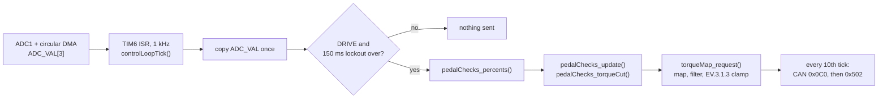

# Torque control

How the VCU turns pedal positions into a torque command, which faults cut torque, and which FSAE 2027 rule each part satisfies. Rule numbers refer to the FSAE Rules 2027 V1.0.

## The 1 kHz loop

- **ADC:** ADC1 converts APPS1, APPS2 and BSE continuously into `ADC_VAL[3]` by circular DMA. The loop reads the latest values; it doesn't wait for a conversion.
- **Rate:** TIM6 runs at 1 kHz (192 MHz APB1 timer clock / 192 / 1000), so the filter's `dt` is a constant 1 ms (`CONTROL_LOOP_DT_S`). The torque frame goes out every 10th tick, 100 Hz.
- **One sample per tick:** the tick copies `ADC_VAL` once, so every check in a tick sees the same reading while DMA keeps writing.
- **Interrupt priority:** TIM6 is at NVIC priority 1, the same as the button and precharge timers and above FDCAN RX (2). `resetVCU()` runs from CAN RX on shutdown-power-lost, so it can never interrupt a half-finished tick and leave an enabled torque frame queued after its 0 Nm lockout frames.
- **During the RTD sound:** the RTD sound plays inside the TIM3 ISR (also priority 1) for about 2.6 s and holds the loop off. That's fine because the car isn't in drive yet.

The pure logic lives in two HAL-free files that the host tests compile directly:

| File | Responsibility |
|---|---|
| `pedal_checks.c` | ADC counts → pedal %, every plausibility check, the cut decision |
| `torque_map.c` | Pedal map table, regen, filter, fault cut, EV.3.1.3 clamp |
| `torque_diag.c` | Byte packing for the `0x502` diagnostics frame |
| `motor_control.c` | Supplies time, car speed and `dt`; holds the shared globals |

## Pedal scaling

APPS read **lower** as the pedal goes down; BSE reads **higher**. Calibration lives in `pedal_checks.h`:

| Sensor | Released (ADC) | Full (ADC) | Valid range |
|---|---|---|---|
| APPS1 | 1400 | 320 | 195 – 1525 (±125 overshoot buffer) |
| APPS2 | 1965 | 470 | 345 – 2090 |
| BSE | 375 | 1500 | 250 – 2780 (open / short thresholds) |

`pedal_percents` are **not** clamped, so the APPS1 vs APPS2 check compares the real readings. `torqueMap_target()` clamps its own inputs to 0–1.

`PEDAL_MODE` is `ONLY_APPS2`: APPS2 sets the torque and drives the crosscheck. APPS1 is still range-checked and compared with APPS2.

## Faults

| Check | Trips when | Reaction | Clears when | Rule |
|---|---|---|---|---|
| APPS out of range | ADC outside the valid range (unplugged reads ~70) | Cut immediately | Back in range, **unless latched** | T.4.2.9, T.4.2.10 |
| BSE out of range | ADC < 250 or > 2780 | Cut immediately | Back in range, **unless latched** | T.4.3.3, T.4.3.4 |
| Sensor fault latch | Any sensor out of range for > 100 ms | Cut, latched | Only by leaving drive (`resetVCU()`) | T.4.2.9, T.4.3.3 |
| APPS disagreement | APPS1 and APPS2 differ by > 10% travel for > 100 ms | Cut | Back within 10% | T.4.2.4, T.4.2.5 |
| Brake + throttle | Brake ADC > 1000 while APPS > 25% | Cut immediately | APPS back to ≤ 5% (brake state doesn't matter) | EV.4.7 |
| Entering drive | Every reset (throttle held at RTD gives no torque) | Cut | APPS ≤ 5% and APPS agree | — |
| Inverter lockout | First 150 ms of drive | No torque frames | Time | Cascadia enable sequence |

**What a cut does:** the request is 0 Nm **on the same tick**. The filter is skipped and reset, and the inverter enable bit stays 1. When the fault clears, torque ramps back up from 0 through the filter instead of stepping back to its old value.

**Why the latch waits 100 ms:** an out-of-range reading always cuts torque at once. It only latches after 100 ms, so a single noisy ADC sample can't strand the car, but a real open or short circuit stays cut even if the connector flickers back.

## Torque map

To see the current map, run the sweep and plot in [tools/](../README.md#tools). They use the real `torque_map.c`.

- **Below `APPS_INFLECTION_PERCENT` (5%):** 0 Nm (coast) while regen is off, the default. Regen region (below) when `REGEN_ENABLED` is 1.
- **Above 5%:** `torqueMap_table` gives the torque at 11 evenly spaced points from 5% to 100% pedal, as a **fraction of `MAX_TORQUE`** (80 Nm). Values in between are interpolated linearly. The default table is a straight line.
- **Table check:** `torqueMap_tableIsValid()` requires the table to start at 0, end at 1, stay within 0–1 and never decrease. It runs at boot (`Error_Handler()` if it fails) and in the tests.

**Regen is off by default** (`REGEN_ENABLED 0` in `torque_map.h`), so testing torque mapping doesn't also test regen, whose speed input isn't trusted yet (see known issues in the README). Regen is reworked on `feature/regen`; this branch stays at 0 until that work passes its bench checks. The tests build both ways (`test_torque_map` and `test_torque_map_regen`), so the regen code below stays covered.

**Regen (when enabled):** below 5% pedal, torque goes linearly from 0 Nm at 5% to `REGEN_MAX_TORQUE` (−30 Nm) at 0%. Regen is cancelled:
- **below 5 km/h** (EV.3.3.3). See the known speed conversion issue in the README: the gate currently opens far below 5 km/h.
- **when the brake is past 5%,** because regen while braking causes large phase currents and trips the inverter.

## Filter and EV.3.1.3

Each tick the map's target goes through:

1. **Low-pass filter:** τ = 50 ms (`RC_TIME_CONSTANT`). A 0 → 80 Nm step reaches 63% in 50 ms.
2. **Slew limit:** 2000 Nm/s (`SLEW_RATE_LIMIT`). At 1 kHz the LPF already moves less than this for any step under ~102 Nm, so in practice the slew limit never engages.
3. **EV.3.1.3 clamp:** the output is kept between 0 Nm and the target, so the VCU can only reduce the driver's request, never add to it. This means:
   - **Pressing the pedal:** torque builds up smoothly.
   - **Lifting off:** torque follows the pedal down on the same tick.
   - **Regen:** builds up gradually and never exceeds what's requested.
   - **Switching between drive and regen:** passes through 0 Nm.
   - **After a clamp:** the filter restarts from the clamped value, so pressing again ramps smoothly.

## Inverter torque frame (0x0C0)

| Byte | Content |
|---|---|
| 0–1 | Torque × 10, little-endian signed (Nm × 10; negative = regen) |
| 2–3 | 0 |
| 4 | Direction: 0 = forward |
| 5 | Inverter enable: 1 in drive, 0 in lockout frames |
| 6–7 | 0 = use the torque limits stored in the inverter EEPROM |

On entering drive, and in `resetVCU()` and `Error_Handler()`, the VCU sends five frames with 0 Nm and enable = 0.

## Torque diagnostics frame (0x502)

Sent right after every `0x0C0` frame (100 Hz in drive), from the same tick, so every field describes the same moment. It answers "why is torque 0?" from a CAN log alone. Packing is in `torque_diag.c`; `tests/test_torque_diag.c` pins the layout.

| Byte | Content | Type, scale |
|---|---|---|
| 0–1 | Driver request: pedal map target, before the filter. Still set on a cut tick | int16 LE, 0.1 Nm |
| 2–3 | Final command, the same value as `0x0C0` bytes 0–1 | int16 LE, 0.1 Nm |
| 4 | APPS travel used for torque (per `PEDAL_MODE`), unclamped so overshoot shows | uint8, 0.5 % (200 = full) |
| 5 | Fault flags, below | bits |
| 6 | `vcu_state`: 0 IDLE, 1 PRECHARGED, 2 DRIVE, 3 CAN_FAULT | uint8 |
| 7 | Rolling counter, +1 per send slot. A jump means a frame was skipped or lost | uint8 |

| Bit of byte 5 | Meaning |
|---|---|
| 0 | APPS1 out of range this tick |
| 1 | APPS2 out of range this tick |
| 2 | BSE out of range this tick |
| 3 | APPS1 vs APPS2 implausible (T.4.2.4) |
| 4 | Brake + throttle crosscheck active (EV.4.7) |
| 5 | Sensor fault latched: a range fault lasted > 100 ms; cleared only by leaving drive |
| 6 | Torque cut this tick (command forced to 0 Nm) |
| 7 | Regen requested (driver request < 0). Always 0 with `REGEN_ENABLED 0`: a quick on-car check that regen is off |

Right after entering drive, bits 3 and 4 are set until the pedal has been released once: that's the startup cut, not a fault.

`0x502` is only queued when at least 2 of the 3 TX FIFO slots are free, so it never takes the last slot from a torque or lockout frame. A skipped frame still advances the counter.

## Rule → code → test

| Rule | Requirement | Code | Tests |
|---|---|---|---|
| T.4.2.4, T.4.2.5 | APPS disagreement > 10% for > 100 ms stops power | `checkAPPS_Plausibility` | `test_disagreement_cuts_after_100ms`, `test_agreement_restores_immediately`, `test_short_disagreement_restarts_timer` |
| T.4.2.9, T.4.2.10 | APPS open/short detected, treated as implausibility | `validateAPPS`, `checkSensorRanges` | `test_overshoot_buffer_boundaries`, `test_unplugged_apps_cuts_immediately`, `test_apps_range_fault_latches_after_100ms` |
| T.4.3.3, T.4.3.4 | BSE failure > 100 ms stops power | `validateBSE`, `checkSensorRanges` | `test_bse_range_boundaries`, `test_bse_open_circuit_cuts_and_latches`, `test_bse_short_circuit_cuts_and_latches`, `test_hard_braking_is_not_a_fault` |
| EV.4.7 | Brake + APPS > 25% stops power until APPS < 5% | `checkAPPS_BSE_Crosscheck` | `test_brake_with_throttle_cuts_immediately`, `test_crosscheck_thresholds`, `test_crosscheck_holds_until_apps_below_5_percent` |
| T.4.2.5, T.4.3.3, EV.4.7 | Power stopped **immediately** | `torqueMap_request` cut path | `test_request_cut_is_instant`, `test_request_cut_blocks_regen` |
| EV.10.6.2, T.4.3.4 | RTD needs the brake held; a failed BSE doesn't count | `pedalChecks_brakeHeldForRTD` (TIM3 RTD callback in `main.c`) | `test_rtd_needs_brake_pressed`, `test_rtd_rejects_failed_bse`, `test_rtd_brake_thresholds_are_ordered` |
| EV.3.1.3 | VCU may only decrease the driver's request | `torqueMap_request` clamp | `test_request_never_exceeds_driver_request` (200k-tick random drive), `test_request_lift_off_is_instant`, `test_request_drive_to_regen_passes_through_zero` |
| EV.3.3.3 | No regen 0–5 km/h | `REGEN_ENABLED 0` (no regen at all), `regenTorque` | `test_regen_disabled_coasts`, `test_regen_cutoff_meets_ev_3_3_3`, `test_no_regen_below_min_carspeed`, `test_regen_allowed_at_min_carspeed` (speed input itself: see known issues) |

Run them with `make -C tests`.
